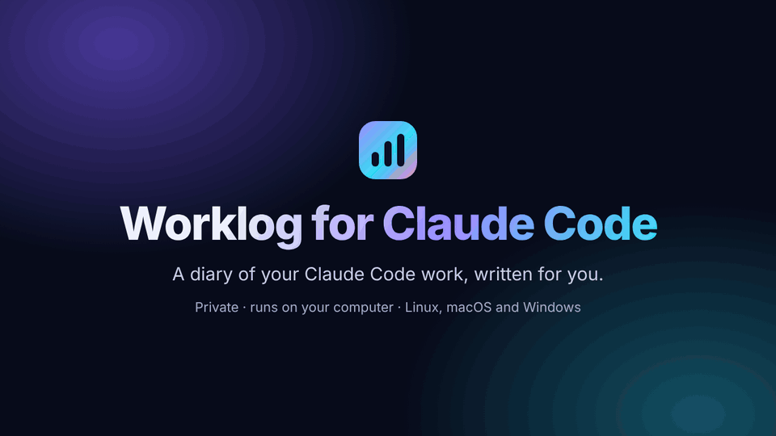
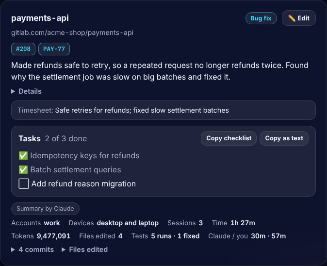
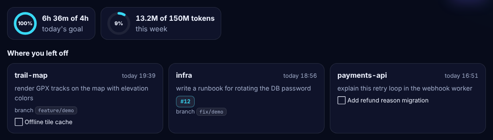
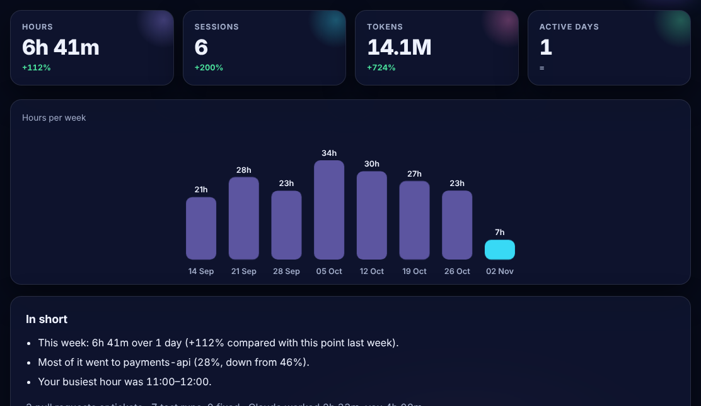
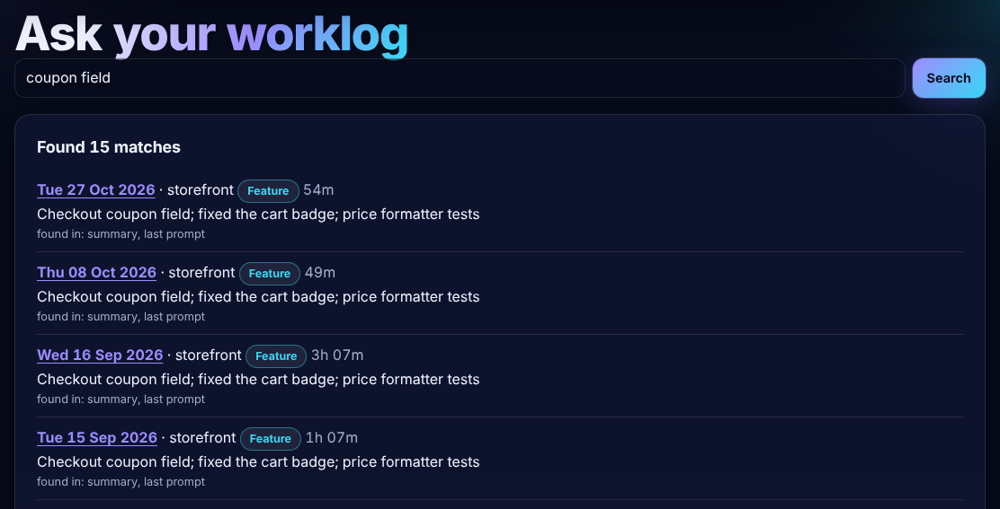
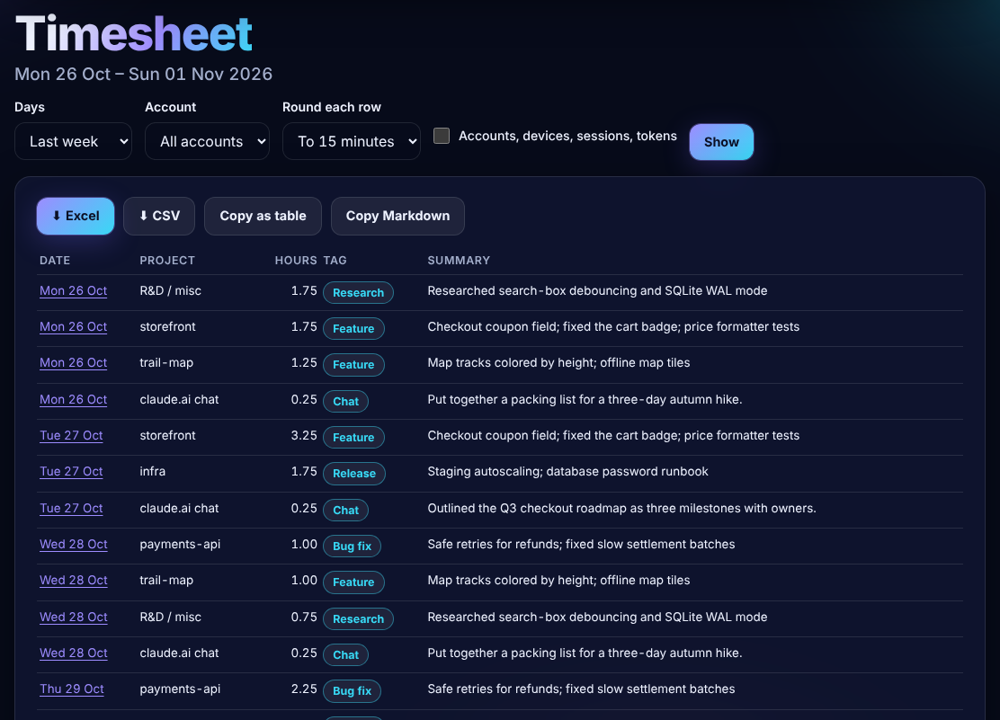
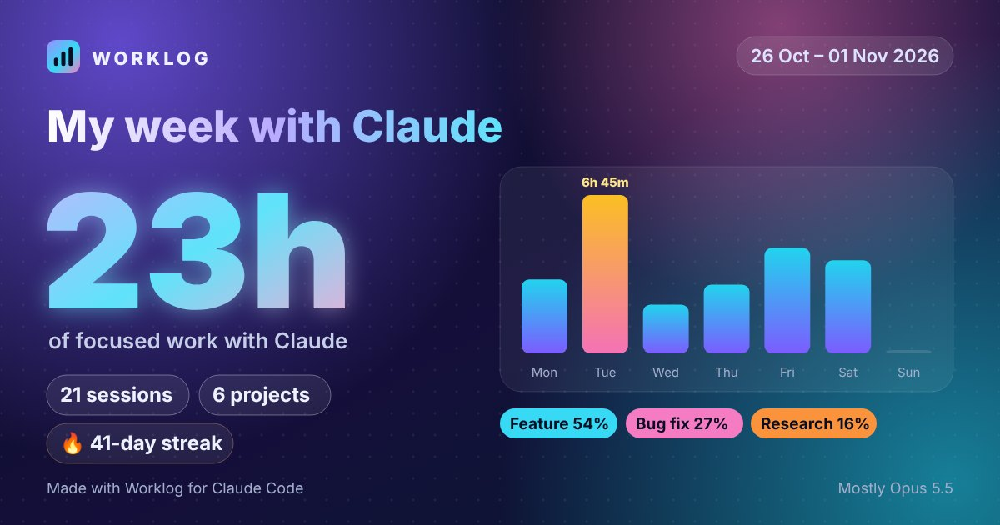

# Worklog for Claude Code

**Your Claude Code work, written down for you: what you did each day, how long it took, and what it used.**

A free, open-source **Claude Code usage tracker** and **daily work log**: tokens, cost and hours **per project**, a timesheet, and plain-language summaries of what you did, across all your Claude accounts and computers. It runs on your computer and keeps your data in your own private git repo.

[](https://pepy.tech/project/worklog-for-claude-code)
[](https://pypi.org/project/worklog-for-claude-code/)
[](https://github.com/us-urvin/worklog-for-claude-code/stargazers)
[](https://github.com/us-urvin/worklog-for-claude-code/actions/workflows/ci.yml)
[](https://github.com/us-urvin/worklog-for-claude-code/blob/main/LICENSE)
[](https://scorecard.dev/viewer/?uri=github.com/us-urvin/worklog-for-claude-code)
[](https://github.com/us-urvin/worklog-for-claude-code/blob/main/SECURITY.md#verify-a-release)

🌐 **[Website](https://us-urvin.github.io/worklog-for-claude-code/)** · 📦 **[PyPI](https://pypi.org/project/worklog-for-claude-code/)**



▶️ **[Watch the 40-second tour](https://github.com/us-urvin/worklog-for-claude-code/blob/main/docs/media/worklog-demo.mp4)**

## What you get

**Every day**
- ✍️ What you worked on, project by project, **in plain words**. Claude writes it with your own account.
- 📍 **Where you left off**: your last projects, open tasks, PRs and tickets.
- ✏️ Wrong project? **Fix it in two clicks**, and Worklog remembers.

**Every week**
- 🧾 A **timesheet** with hours, kind of work and one line per project. Download it for Excel or as CSV.
- 📈 **Trends** compared with last week, in plain sentences, plus **goals** for hours and tokens.
- 🔎 **Ask your worklog**: *"When did I review PR 505?"*

**Anywhere**
- 📱 On your **phone** through the GitHub app, from a summary in your private data repo.
- 🖼️ A **card to share** your week. It shows totals only, never prompts or files.
- 👥 Several **Claude accounts and computers**, even with one-click account switchers.

🔒 **Private**: everything stays on your computer and in your own private git repo. 💻 Runs on **Linux, macOS and Windows**. ⚡ Light and fast.

## Try it (nothing is installed)

```bash
pipx run --spec worklog-for-claude-code claude-worklog demo
```

Open **http://localhost:8766** to look around with made-up data. Press **Ctrl+C** to stop.

## Install in 3 steps

You need **Python 3.10+**, **git** and **[Claude Code](https://code.claude.com/docs)**. No pipx yet? See the [beginner guide](https://github.com/us-urvin/worklog-for-claude-code/blob/main/docs/GETTING-STARTED.md).

**1. Install**

```bash
pipx install worklog-for-claude-code
```

**2. Create a folder for your log and start Worklog**

```bash
git init ~/claude-worklog-data          # Windows PowerShell: git init "$HOME\claude-worklog-data"
claude-worklog install-service
```

**3. Open http://worklog.localhost:8765** (or http://localhost:8765) and fill in the short form.

A checklist shows anything still missing, with the exact command for your computer, and disappears when everything is ticked. Then just use Claude Code as usual.

## A closer look

<table><tr>
<td width="50%"><br><b>Every project, in plain words</b>, with tasks and PRs.</td>
<td width="50%"><br><b>Goals and where you left off</b>, at the top of Today.</td>
</tr><tr>
<td width="50%"><br><b>Trends</b>, compared with last week.</td>
<td width="50%"><br><b>Ask your worklog</b> anything about past work.</td>
</tr><tr>
<td width="50%"><br><b>A timesheet</b>, ready for Excel.</td>
<td width="50%"><br><b>A card to share</b> your week.</td>
</tr></table>

## Privacy and trust

- Only short notes are saved: the first 300 characters of your prompts, token counts, file names and commit messages. **Never your files or Claude's replies.**
- Common secrets (API keys, passwords, e-mails) are blanked out before saving. This is best effort, so keep your data repo **private**.
- Summaries and "Ask Claude" use your own Claude account. Turn AI off in Settings to stay fully offline.
- The only other request: once a day, Worklog asks pypi.org whether a new version is out. Nothing about you is sent, and you can turn it off.
- It's a **personal log, not a performance score**. Hours are your active time with Claude, not a measure of your output.
- Every release is built and signed by GitHub, and checked on Linux, macOS and Windows before it's published. [Verify a release →](https://github.com/us-urvin/worklog-for-claude-code/blob/main/SECURITY.md#verify-a-release)

[Privacy in detail →](https://github.com/us-urvin/worklog-for-claude-code/blob/main/docs/GUIDE.md#privacy)

## Questions

**Can I see it on my phone?** Yes. Turn on **Settings → On your phone** on one computer, then open your data repo's `phone` folder in the GitHub app. It stays private.

**Wrong project on a card?** Click **✏️ Edit** to rename it or move the sessions. Worklog can remember the folder you always start in.

**Several accounts, computers or GitHub accounts?** Settings walks you through it. **Test connection** shows which GitHub account your computer signs in as. See [Full setup](https://github.com/us-urvin/worklog-for-claude-code/blob/main/docs/GUIDE.md#full-setup).

**It says Sonnet, but I use Opus?** The "By model" list shows what Claude Code really used. For better summaries, pick **Opus** in Settings → Summaries.

**How do I update?** Click **Update now** when the dashboard says a new version is out. From a terminal: `pipx upgrade --pip-args=--no-cache-dir worklog-for-claude-code`, then click **Restart now** on the page. ([Still the old version?](https://github.com/us-urvin/worklog-for-claude-code/blob/main/docs/TROUBLESHOOTING.md#i-updated-but-the-page-still-shows-the-old-version))

**Something isn't working?** Run `claude-worklog doctor`, or see [Troubleshooting](https://github.com/us-urvin/worklog-for-claude-code/blob/main/docs/TROUBLESHOOTING.md).

**How do I remove it?** `claude-worklog uninstall-service`, then `pipx uninstall worklog-for-claude-code`. Your log stays.

## Like it? ⭐

If Worklog saves you time, please **[star it on GitHub](https://github.com/us-urvin/worklog-for-claude-code)**. It helps others find it.

📘 [Beginner guide](https://github.com/us-urvin/worklog-for-claude-code/blob/main/docs/GETTING-STARTED.md) · 📖 [Full guide](https://github.com/us-urvin/worklog-for-claude-code/blob/main/docs/GUIDE.md) · 🐛 [Report a bug](https://github.com/us-urvin/worklog-for-claude-code/issues/new/choose) · 📝 [Changelog](https://github.com/us-urvin/worklog-for-claude-code/blob/main/CHANGELOG.md)

---

[MIT](https://github.com/us-urvin/worklog-for-claude-code/blob/main/LICENSE) © 2026 Urvin · Not affiliated with or endorsed by Anthropic.
